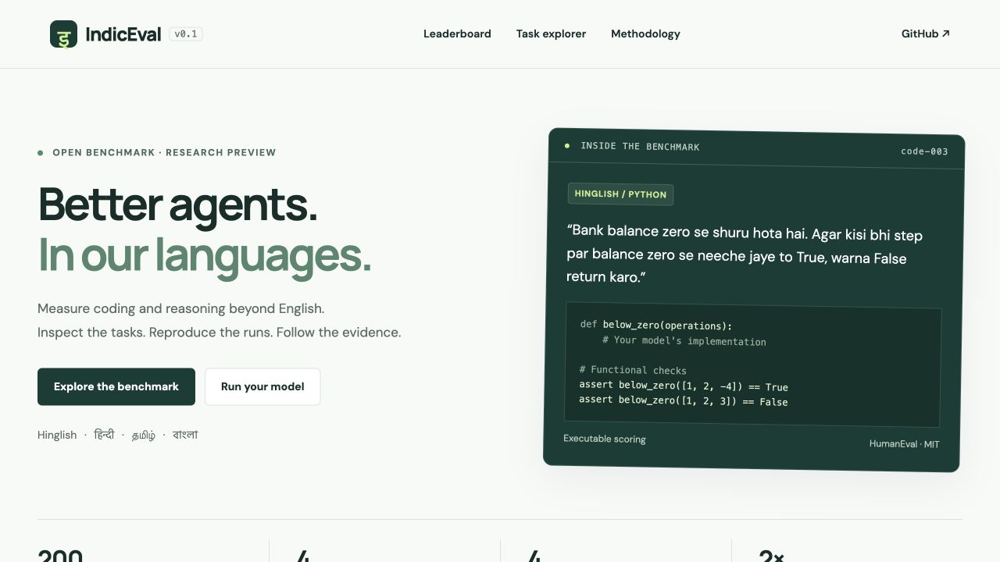
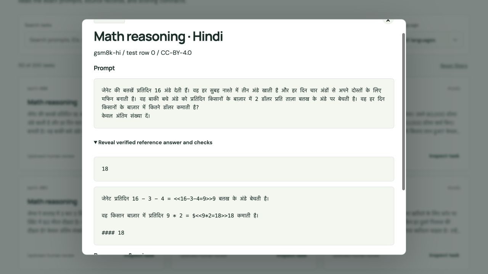
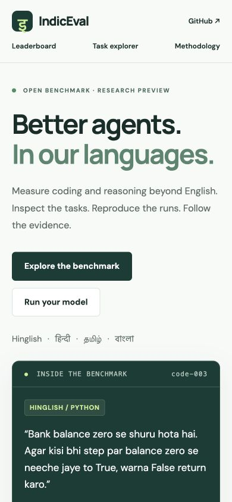

# IndicEval

**Evidence before rankings.** A reproducible evaluation harness and open task
explorer for Hinglish and Indic-language coding and reasoning.

**Live:** https://indiceval.vercel.app  
**Status:** research preview, not a fully human-validated benchmark.
Independent project; not affiliated with IndicEval-XL or other similarly named
benchmarks. No model results have been accepted yet.

## What ships

- 200 sourced tasks across four task types, with pinned upstream revisions,
  source item IDs, licences, transformations and content hashes.
- Python + uv runner for OpenAI-compatible chat-completions endpoints.
- Accuracy, unbiased pass@k, per-task estimated cost, latency, error accounting,
  per-track breakdowns and repeated-run sample variance.
- Docker-isolated Python grading; deterministic numeric/exact-match scoring.
- Public task explorer, answer/source inspection, local JSON report inspector.
- Submission templates, regrading validator and maintainer acceptance script.
- Methodology, contamination notes, privacy, terms and licence/consent ledger.

## Read the scope before using a score

| Task type | Language | Count | Source | Review evidence |
| --- | --- | ---: | --- | --- |
| Code generation | Hinglish | 50 | HumanEval adaptations | English sources human-written; new Hinglish review pending |
| Math reasoning | Hindi | 50 | NVIDIA GSM8K-Hi | Upstream human review/correction |
| Causal reasoning | Tamil | 50 | XCOPA | Upstream human translation/reannotation |
| Reading comprehension | Bengali | 50 | IndicGenBench XQuAD-IN | Upstream professional human translation |

150 tasks retain upstream human-review evidence. The 50 new Hinglish adaptations
are **not independently human-reviewed**. Executable reference checks do not
replace language review.

Type and language are confounded. Do not use the breakdown to claim one language
is harder than another. These public benchmark derivatives may be contaminated.
This release measures single-turn backend capabilities, not full agent workflows.

## Quick start

Requires Python 3.11+, uv and a running Docker engine.

    git clone https://github.com/SayedZahur786/indiceval.git
    cd indiceval
    uv sync --frozen
    docker pull python:3.12-slim
    uv run indiceval validate-data

Set INDICEVAL_API_KEY, MODEL_BASE_URL and MODEL_ID in your shell. Base URL is the
endpoint's API root (often ending in /v1), not /chat/completions. Never commit a
populated environment file. The runner reads environment variables; it does not
automatically load .env files.

    uv run indiceval run \
      --base-url "$MODEL_BASE_URL" \
      --model "$MODEL_ID" \
      --repeats 2 --samples 5 --k 1 5 \
      --temperature 0.7 \
      --output runs/my-model

Set --input-price and --output-price to your provider's USD price per million
tokens when known. Omitted prices or absent usage produce unknown cost, not zero.
Use --limit for development only; partial runs cannot be submitted. Output
directories must be new so an experiment cannot silently overwrite another.

The default protocol sends seed, temperature and max_tokens in chat-completions
requests. Endpoints that reject those fields need an adapter; failures are
recorded rather than silently changing the experiment.

## Artifacts and metrics

Each run writes run.json, samples.jsonl and report.json. Metadata records dataset
hash, task IDs, endpoint, model, seed, sampling, declared prices, Python version,
git commit, dirty-tree status and resolved Docker image ID. Secrets and raw
provider error bodies are not persisted.

- Accuracy: first sample per task, averaged over repetitions.
- pass@k: 1 − C(n−c,k)/C(n,k), averaged across task/repetition groups; k ≤ n.
- Variance: sample variance of repetition accuracies, denominator R−1. Reported
  in squared proportions, not percentage points. Two repeats are not a confidence
  interval or proof that a small ranking difference is meaningful.
- Cost/task: all n samples, averaged over task/repetition groups; unknown if any
  sample lacks usage/pricing. Cache, tool and hardware costs are not estimated.
- Latency: HTTP wall time, excluding grading; p95 uses nearest rank.
- Request failures and invalid answers stay in the denominator. No hidden retry.

    uv run indiceval validate-run runs/my-model --submission

Submission validation requires the full dataset and at least two repetitions,
recomputes metrics and costs, and regrades stored outputs. It is not proof that
the stated provider actually generated the outputs. Maintainers review evidence
and contamination disclosures before publication.

See [CONTRIBUTING.md](CONTRIBUTING.md). Maintainers can import a reviewed bundle:

    uv run python scripts/accept_submission.py runs/my-model \
      --review-url "$GITHUB_REVIEW_URL"

That command prepares a local diff; it does not push or publish by itself.

## Verification

    uv run pytest -q
    uv run python scripts/verify_answers.py
    uv run python scripts/reference_run.py --output work/new-reference-run

The checked-in diagnostic uses a local HTTP fixture that returns published
reference answers. It is **not a model** and cannot enter the leaderboard.
The complete diagnostic made 400 requests across two repetitions:
200/200 passes each time; observed score variance 0; cost unknown because no
provider usage was reported. See [raw evidence](docs/evidence/reference-run).

The answer-verification ledger records all 200 checks: 50 reference solutions
executed in Docker, arithmetic annotations evaluated, causal labels matched to
the source, and reading answers checked against source spans. This does not
constitute independent semantic human review of every task.

Local pytest passes. GitHub Actions is configured but the first remote job was
not started: GitHub reported an account billing lock. See [LAUNCH.md](LAUNCH.md).

## Screenshots

## Develop and deploy

    uv run python scripts/build_pages.py
    uv run python scripts/build_site.py
    python3 -m http.server 8765 --directory site

The site is plain HTML/CSS/JavaScript. No client or server stores API keys.
Report inspection runs locally in the browser. Vercel Web Analytics is enabled;
the client skips analytics when Do Not Track is enabled.

    vercel deploy
    vercel deploy --prod

Use the preview deployment to review changes before promoting. The build copies
only the static site output. Raw benchmark sources, Python tooling and local
secrets are not publicly served by the web app.

## Data rights and research context

Code: MIT. Records retain upstream MIT, CC BY 4.0 or CC BY-SA 4.0 licences.
See [source ledger](data/sources.json), [licence texts](data/licenses), and the
[public attribution page](https://indiceval.vercel.app/sources.html).

Published licences are the redistribution basis. Individual upstream annotator
consent paperwork has not been audited and is not provided by those releases.
No private messages, scraped forum posts or new participant data are included.

Built on [HumanEval](https://github.com/openai/human-eval),
[GSM8K-Hi](https://huggingface.co/datasets/nvidia/GSM8K-Hi),
[XCOPA](https://github.com/cambridgeltl/xcopa), and
[IndicGenBench](https://github.com/google-research-datasets/indic-gen-bench).
Preserve their notices and cite those sources alongside this harness.

## Known gaps

1. Independent human review of all 50 Hinglish adaptations remains outstanding.
2. No real model baseline has been run; a provider endpoint/key is needed.
3. Upstream individual consent records are unavailable.
4. Remote CI is blocked by the GitHub account billing lock.
5. Four coupled strata and public source data limit scientific comparisons.
6. Docker grading is not a hardened multi-tenant or adversarial grading service.

See [SPEC.md](SPEC.md), [design review](docs/DESIGN_REVIEW.md),
[launch gate](LAUNCH.md) and [three launch drafts](docs/LAUNCH_POSTS.md).
